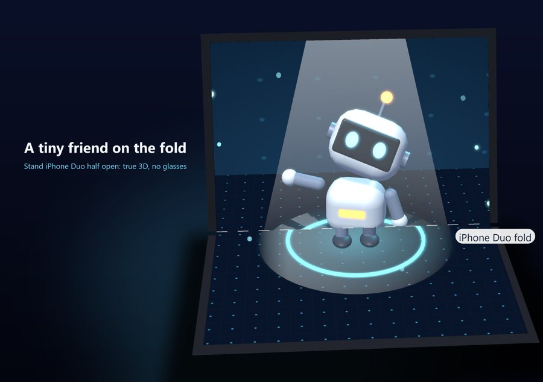
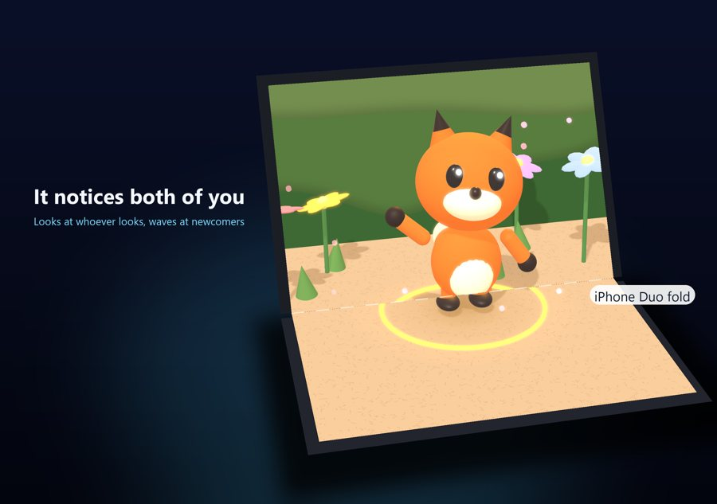
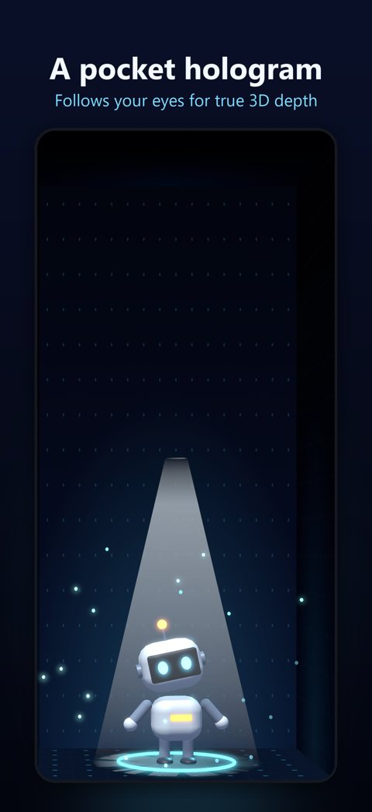
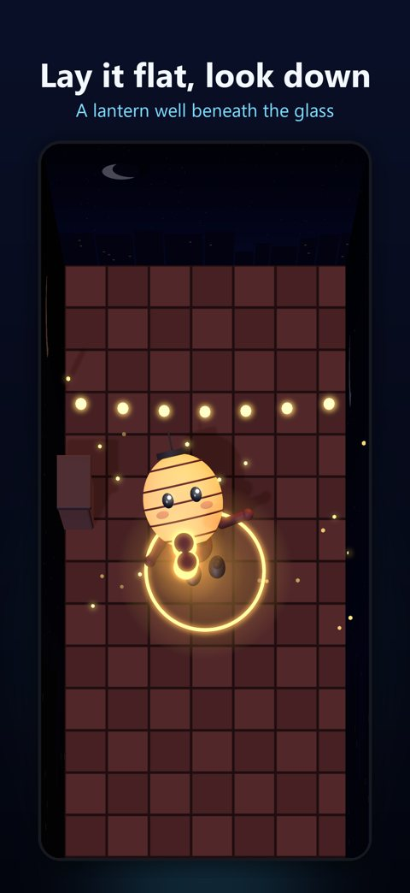
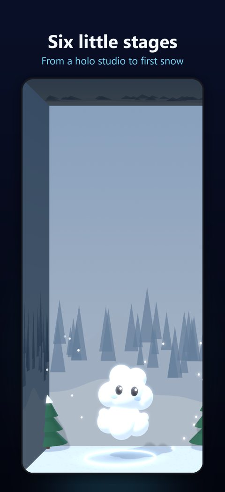
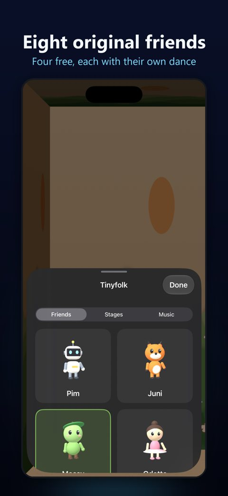

# Tinyfolk: Pocket Hologram

A tiny 3D friend that lives in your iPhone. Tinyfolk follows your eyes with the front camera and draws a small
world from exactly your point of view, so the character looks like it is standing right there, in front of you.

  
  

  
  
  
  

- **iPhone Duo, half open:** stand it like a tiny laptop. The upper half becomes the back wall, the lower half the
  floor, and the character stands on the fold. Both halves are drawn with their own off-axis projection from your
  eye, using the live hinge angle, so the floor and backdrop look flat and continuous at any angle.
- **iPhone Duo, fully open:** a surprise. The floor gives way and your friend falls into a lantern well beneath the
  glass. Paper lanterns rise and knock against the glass from below (you feel each knock).
- **Two people:** the view follows one person at a time (a flat screen can only be right for one eye point), but the
  character notices both: it looks at whoever is looking, turns between you, and waves when a second person arrives.
- **Every other iPhone and iPad:** the screen becomes a window into a little diorama box; lay it flat to look down
  into the well.

No account, no ads, no data collection. Camera frames are analysed on the device and dropped immediately.

## How it works

| Piece | File |
|---|---|
| Off-axis projection (Kooima), stage and window layouts | `Tinyfolk/Core/Projection.swift` |
| Face → eye position, two-viewer tracking, primary viewer and attention | `Tinyfolk/Core/Viewers.swift` |
| One-euro filter, critically damped springs | `Tinyfolk/Core/Filters.swift` |
| Character behaviour (look, blink, wave, dance on the beat) | `Tinyfolk/Core/Brain.swift` |
| Front camera + Vision, automatic image-orientation calibration | `Tinyfolk/Tracking/FaceTracker.swift` |
| SceneKit scene, two cameras, trapdoor transition, lanterns | `Tinyfolk/Render/World.swift` |
| Cast (8 original characters) and stages (6) | `Tinyfolk/Render/Cast.swift`, `Stages.swift` |
| Music: arranger and synthesizer (no samples) | `Tinyfolk/Music/Score.swift`, `Tinyfolk/Audio/Synth.swift` |

SceneKit is used because it is the only Apple scene renderer that accepts an arbitrary camera projection matrix on
iOS, which off-axis rendering needs. All motion is computed in one display-link step, so the two views of the shared
scene always agree at the fold.

## Simulator and testing

There is no camera or hinge in the simulator, so Tinyfolk simulates viewers there: open **Settings → Simulate
viewers and hinge** for sliders (viewer A and B positions, who is looking, hinge angle, presentation). On a device
the same panel appears after tapping **Version** five times.

Unit tests (`TinyfolkTests`) cover the projection (corners, sight lines, seamless fold at every angle), viewer
hand-off and attention, the brain, every piece of music, and an offline render of the real audio graph.

## Build

XcodeGen project (`project.yml`). CI: `.github/workflows/ios-testflight.yml` (tests → TestFlight on the `xcode-27`
runner), `.github/workflows/screenshots.yml` (App Store screenshots from the simulator).

## Licence

MIT. Music: original pieces written for Tinyfolk, plus public-domain tunes (Üsküdar'a Gider İken, Greensleeves,
The Entertainer by S. Joplin, Wiegenlied by J. Brahms). All instrumental.
